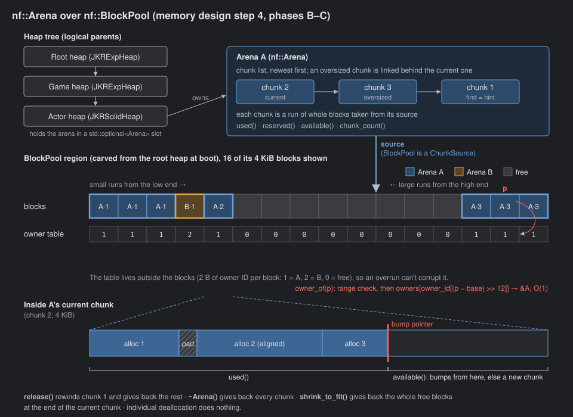

# Memory model: design

> **Status: steps 0 and 1 done; steps 2 and 4 next (step 4 phase A done; [Step 4 plan](#step-4-plan)).** Step 1's checker (`tools/utilities/implicit_alloc_check.py`, page [implicit-allocations.md](implicit-allocations.md)) counts 1,912 implicit allocations, 988 deletes and 166 current-heap switches (2026-11-16). Step 0 built: `nf_memory` (header-only: `Box`/`make_box` in `box.hpp`, the `start_lifetime_as` wrapper in `lifetime.hpp`) with tests in `tests/nightfall/memory/`; `JKRHeap` is a `std::pmr::memory_resource` (`do_allocate` aborts on a null result, a size over `UINT32_MAX` or an alignment of 128 or more; `do_is_equal` is identity), tested in `tests/JSystem/JKernel/JKRHeap_resource_test.cpp`; JKRExpHeap and JKRSolidHeap align every default allocation to `MIN_ALLOC_ALIGN` (`alignof(std::max_align_t)`, in `JKRHeap.h`; `CMemBlock` is `alignas` it and block sizes are rounded to it), tested in `tests/JSystem/JKernel/JKRHeap_alignment_test.cpp`; a parentless heap records the thread that constructs it as its owner, and in builds with assertions `getCurrentHeap`, `setCurrentHeap`, `becomeCurrentHeap` and the null-heap path of `JKRHeap::alloc` (the global `operator new`, `JKRAllocFromHeap(nullptr, …)`) abort on any other thread once a current heap is set, tested in `tests/JSystem/JKernel/JKRHeap_thread_test.cpp`; `JKRThreadSwitch` no longer swaps the current heap per thread, and the worker threads no longer set one (the JAS threads' `setCurrentHeap`, the assert heap that `mDoDvdThd`, the memory card and DVD error threads installed). Decisions recorded here were made with the developer on 2026-11-10. The survey this builds on is [memory-model.md](memory-model.md); its requirements are referred to as R1–R8. Open questions are listed at the end.

The goal is memory management that is strict by default, in the spirit of Rust: every allocation names the heap it comes from, every heap has an owner that decides its lifetime, and the host program's own allocations never mix with the game's. Budgets become per-platform configuration instead of constants tuned for a 24 MiB console. The game keeps running at every step along the way.

## Decisions

| Topic | Decision |
|---|---|
| Heap interface | **`std::pmr::memory_resource`** (C++17), the C++ counterpart of Rust's `Allocator` trait. All heaps, old and new, are memory resources. |
| Existing heaps | **`JKRHeap` becomes a `memory_resource`** instead of hiding behind a new layer. Every `JKRHeap*` then works with `std::pmr` containers as it is, and the engine's own APIs (`new (heap, align)`, `JKRAllocFromHeap`) keep working. The JKR heaps are later rebuilt on the new heap classes. |
| Heap selection | **Explicit everywhere.** Each `new`/`delete` in engine code names its heap. The implicit "current heap" goes away module by module, in the order JSystem → `f_*`/`m_Do` → `d_*` → actors, and a checker counts what is left. |
| Solid heaps | **Chunked arenas** replace "take all free space, build, then shrink". An arena grows in chunks taken from its parent, so the parent is never blocked. |
| Object lifetimes in file data | **`start_lifetime_as`** (C++23, P2590) for reading baked file data as structs, through a small `nf::` wrapper. The wrapper uses the standard function where the library has it and a C++20 fallback otherwise (the Vita's GCC 15.2 library and libc++ lack it), so no toolchain is required to have it. |
| Language standard | **C++23 for the engine.** `tp::config` requires `cxx_std_23` (since 2026-11-11), so the whole engine compiles as C++23. The analysis scripts default to `-std=c++23` too. Both GCC 16.2 and clang 23 build every TU as before, and all tests pass. |
| macOS toolchain | **Apple clang stays supported.** It lacks `std::start_lifetime_as` and gets the fallback. |

## Toolchain facts this relies on

Checked on 2026-11-10:

| | GCC 16.2 + libstdc++ (Linux) | clang 23 + libstdc++ (Linux) | `arm-vita-eabi-g++` 15.2 (Vita) | Apple clang + libc++ (macOS) |
|---|---|---|---|---|
| `<memory_resource>` | yes | yes | yes (`__cpp_lib_memory_resource` 201603) | yes (cppreference) |
| `std::start_lifetime_as` | yes (`__cpp_lib_start_lifetime_as` 202207, `-std=c++23`) | yes (same library) | **no** | **no** (cppreference lists libc++ without it) |

`start_lifetime_as` is a library feature, so support follows the standard library, not the compiler: clang on Linux uses libstdc++ by default and has it, while cppreference's "Clang" column means LLVM's libc++, which Apple clang ships. The libc++ result was not tested here (Fedora's `libcxx-devel` headers aren't installed). On a Mac, `echo '#include <version>' | clang++ -std=c++23 -dM -E -x c++ - | grep lifetime_as` prints the macro if a later Xcode adds it.

The engine is built with `-fno-exceptions` (`cmake/TPConfig.cmake:79`). `memory_resource::allocate` must not return null, so a failed `std::pmr` allocation ends the program, which matches Rust's default `handle_alloc_error`. The engine's own allocation calls (`JKRHeap::alloc`, `new (heap, align)`) keep returning NULL on failure, because the game handles that (see *Failure policy*).

## Architecture

### The `nf_memory` module

New code lives in `include/nightfall/memory/`, `src/nightfall/memory/`, tests in `tests/nightfall/memory/`, target `nf_memory` (alias `nf::memory`), namespace `nf`. It has no dependency on the engine. JKernel links it.

| Piece | Rust counterpart | Purpose |
|---|---|---|
| `nf::ResourceDelete`, `nf::Box<T>` = `std::unique_ptr<T, ResourceDelete>` | `Box<T, A>` | An owning pointer that remembers which resource it came from and gives the memory back to it. This replaces the `HeapBox` of the RARC design. |
| `nf::BoxArray<T>` | `Box<[T], A>` | Owning, fixed-length array from a resource. It replaces `HeapArray`. |
| `nf::make_box<T>(resource, args…)` | `Box::new_in` | Allocates and constructs in one step, so a raw pointer is never exposed. |
| `nf::Arena` | a bump arena with a lifetime (`bumpalo`) | Chunked bump allocator, described below. |
| `nf::BlockPool` | a page allocator | Fixed-size 4 KiB blocks with an out-of-line table of `u16` owner IDs: chunks for the arenas, O(1) lookup of a pointer's owner, guard blocks in debug builds on the hosts. See *Step 4 plan*. |
| `nf::GeneralHeap` | a general allocator | Free-list allocator with individual frees, allocation from either end, and group IDs, i.e. what `JKRExpHeap` does today. |
| `nf::Budget` | none | Wrapper that counts bytes against a limit and reports the peak. |
| `nf::start_lifetime_as<T>(p)`, `nf::start_lifetime_as_array<T>(p, n)` | `bytemuck::from_bytes` | Calls `std::start_lifetime_as` when `__cpp_lib_start_lifetime_as` is defined. Otherwise it falls back to the C++20 way of creating objects in place, `std::memmove(p, p, size)` followed by `std::launder`. Restricted to trivially copyable `T` with a `static_assert`. |

All types are move-only where they own memory, constructors that can fail are replaced by factory functions returning `std::optional` (or `std::expected`, C++23), and the public API is `[[nodiscard]]` wherever dropping a result would leak.

### `JKRHeap` as a resource

```cpp
class JKRHeap : public JKRDisposer, public std::pmr::memory_resource {
    // ...existing interface unchanged...
private:
    void* do_allocate(std::size_t n, std::size_t a) override;       // alloc(); a failure ends the program
    void  do_deallocate(void* p, std::size_t, std::size_t) override { free(p); }
    bool  do_is_equal(const memory_resource& o) const noexcept override { return this == &o; }
};
```

`JKRHeap` gains a base class, which changes its layout. That is fine, since matching the original binary is not a goal. The memory heaps hand out keeps whatever alignment is asked for, with the minimum below.

### The current heap

* **Step 1: main thread only** (decided 2026-11-11; `thread_local` fails on the Vita, see below). `JKRHeap::sCurrentHeap` stays one global, and only the main thread uses it. The worker threads (JAudio2's audio and DVD threads, `mDoDvdThd`, the JKR ARAM and decompression threads) switch to explicit heaps first, as the start of step 2. In debug builds the implicit `operator new` asserts that it runs on the main thread, which catches the race (R2). The heap-swapping part of `JKRThreadSwitch::callback` is removed, because neither the hosts nor the Vita have the console's thread-switch hook.
* **Why not `thread_local`:** on the Vita GCC implements it with emutls on pthread keys, and `abiprobe` (2026-11-11) found it broken. On `sceKernelCreateThread` threads, the threads saw each other's values (381,894 wrong reads out of about 800,000), and the `std::thread` case crashed. A per-thread slot through `sceKernelGetTLSAddr` would work but needs platform code that step 2 deletes again.
* **Then gone.** Once a module no longer uses it (see *Order of work*), its "make current … restore" pairs are deleted. When no engine module uses it, `getCurrentHeap`/`becomeCurrentHeap` are removed.

### Alignment

The minimum alignment of every heap is `alignof(std::max_align_t)`: 16 on 64-bit hosts and 8 on the Vita, up from the console's 4 (R7). Requests for more (SIMD, GPU buffers) are honoured as asked.

The Vita needs 8, measured with `tools/vita-bench` `abiprobe` on 2026-11-11. `ldr`/`ldrh` at any offset and `ldm`/`ldrd`/`vldr`/unhinted `vld1` at 4 mod 8 work, but `vld1` with an alignment hint (`:64`, `:128`) faults when misaligned, and GCC emits `vld1.64 … [r0 :64]` when it vectorises a plain `uint64_t` loop. A `uint64_t` array from a 4-aligned heap crashed it. newlib's `malloc` and `new` give 8, as does `__STDCPP_DEFAULT_NEW_ALIGNMENT__`.

### Separating the program from the game heaps

* **One reservation.** At boot, the platform layer takes one block of memory for all game heaps: `mmap` or `malloc` on the hosts, a kernel memory block on the Vita. Its size comes from the platform's budget configuration. The root heap is created over it, as with today's arena.
* **Global `operator new`/`delete` go to the host allocator** once the engine allocates explicitly everywhere (R1). The standard library, gtest and any other library then never touch a game heap.
* **`delete` is routed by address.** `operator delete(p)` checks whether `p` lies inside the reservation; if so, it hands `p` to the game heap that owns it, otherwise to the host allocator. A range check replaces today's heap-tree walk (`findFromRoot`) on every `delete`. During the transition this also keeps `delete` correct for objects that were created with an explicit heap.

### Arenas instead of "take all, then shrink"

`nf::Arena` takes chunks from a source as it needs them, frees them all at once, and can return the unused end of its last chunk ("shrink"). The source is `nf::BlockPool`: chunks are runs of 4 KiB blocks whose owner is recorded in a table outside the blocks, so looking up which heap owns a pointer takes constant time (see *Step 4 plan*). It is not contiguous across chunks; none of the current solid-heap users need contiguity. This:

* Stops one open heap from blocking its parent (R6). Today a size-0 solid heap takes all of the parent's free space until it is shrunk.
* **Turns sizes measured on the console into hints** (R4). An actor's literal estimate becomes the size of its first chunk. The actor heap's retry logic (`fopAcM_entrySolidHeap_`'s fallback to the largest free block) goes away, and with it the need for heap callbacks to be safe to run twice.
* Turns the `MEMA` room-block sizes from the stage files into hints for the room arenas' first chunk, instead of hard limits.

`JKRSolidHeap` is then rebuilt on `nf::Arena` and `JKRExpHeap` on `nf::GeneralHeap`, keeping their engine-facing interfaces (`freeAll`, `adjustSize`, group IDs).

### Lifetime owners

Each tier from the survey gets an owner object holding its arena or heap. Destroying the owner frees the memory, so lifetimes become RAII instead of manual `freeAll`/`destroy` calls:

| Tier | Owner (where it lives) |
|---|---|
| Process | Boot (`mDoMch_Create`), for the system and Zelda heaps |
| Scene | The scene process; it holds the scene's 2D, message and particle heaps |
| Stage | `dStage_roomControl_c`: the room arenas |
| Room | The room's arena; `freeAll` when the room is unloaded |
| Actor | The actor; its arena is freed with the actor |
| Resource | `dRes_info_c` (already reference-counted): the archive and its data arena |
| Menu | The menu object; its sub-heaps of the 2D heap |

**Debug checks:**
* **Fill freed memory:** freed chunks get a fill pattern.
* **Generation counter:** each arena counts how many times it has been reset, so debug-only handles can detect use after a tier has ended.

This is where Rust's lifetimes are approximated at run time, since C++ cannot check them at compile time. The checks build on the JKR debug-fill flags that already exist.

### Budgets

* **Per platform:** the root reservation, the size of each fixed heap, the ARAM size and the arena chunk sizes come from a per-platform configuration table instead of the constants in `mDoMch_Create` (R3).
* **Counting:** `nf::Budget` counts the bytes used per tier, so the game's memory use can be read per tier on every platform.
* **Console-budget mode** (hosts, optional): enforces the Vita's limits, so a regression shows up on the dev PC instead of on the device. With 358 MiB of user memory and 112 MiB of CDRAM for the app ([vita-storage.md](vita-storage.md#memory)), the Vita's own limits are generous; the main purpose is catching leaks and unbounded growth.

### Resident set and cache tier

> **Status: decided 2026-11-11 from Vita measurements** ([vita-storage.md](vita-storage.md)); the budget is still open.

TP uses ARAM as a cache: archives are loaded once and copied into main RAM when used. The port keeps that *policy* but not the mechanism, and extends it to everything loaded from storage, because Vita storage is slow: 8–10 MiB/s, and the OS keeps no read cache, so anything read again comes from storage again ([vita-storage.md](vita-storage.md)). Reading `AlAnm` (3.8 MiB) a second time would cost about 400 ms.

* **Cache tier.** A budgeted cache of pack entries, keyed by index entry, with least-recently-used eviction. It sits in front of archive mounting in the DVD thread (`mDoDvdThd_*`): a mount checks the cache before reading storage. It is built on `nf_memory` (`Budget` plus a general heap). Returning to a recent area then needs no storage access.
* **Resident set.** What the logo scene mounts to ARAM today (about 25 archives, 6.8 MiB decompressed on GZ2E01, see [memory-model.md](memory-model.md#aram)) becomes pinned cache entries that are never evicted. Graphics stop using the ARAM pool: these archives live in main memory and callers keep using `readResource`/`getResource` (option B from the ARAM discussion). The few places that know an archive is an ARAM archive change: `dLib_getExpandSizeFromAramArchive` (`d_lib.cpp:277`, 4 callers), `d_s_play.cpp:921`, and the mount helpers in `d_s_logo.cpp`/`m_Do_dvd_thread.cpp`.
* **Compressed entries** (LZ4HC, ratio 1.70 on the benchmark corpus) are cached as read and decompressed once into the destination heap, at about 62 MiB/s on one core. That replaces today's copy out of ARAM, so it adds no copy, and the cache holds 1.7× as much per MiB.
* **Reading in place later (option C).** Once formats are baked, consumers can point into the loaded archive instead of copying, starting with Link's animations (`daPy_anmHeap_c`). This works for entries loaded uncompressed into a heap.
* **Audio keeps its ARAM pool, emulated** (decided 2026-11-11). For audio, ARAM is where samples live while they play, not a cache, and JAudio2 addresses it by `u32` offset throughout ([memory-model.md](memory-model.md#aram)). The same approach Nintendo used on the Wii (`aralt`):
  * The pool is one main-memory block. ARAM addresses stay `u32` offsets into it, transfers become `memcpy`, and completion callbacks fire in the original order. The software mixer reads a voice's samples at pool base plus `mWaveAramAddress`. Nothing above `JASDSPChannel` changes.
  * Its size comes from the budget table, defaulting to the console's 10 MiB so Z2's load and erase policy behaves as tuned. Offsets are `u32`, so it can grow without code changes.
  * Wave banks load through the pack files: `JKRDvdAramRipper::loadToAram` becomes one whole-entry read straight into the bank's pool region (a 2 MiB bank costs about 200 ms at the measured throughput). The cache tier may keep erased banks so re-entering an area doesn't reread them; that holds a bank twice (pool and cache), so the budget decides.
  * The stream keeps its 197 KiB ring buffer in the pool, filled by about 5 small reads per second; its ~4 s of buffer covers the longest measured single read (`AlAnm`, 370 ms).
  * Samples stay DSP-ADPCM and the mixer decodes them while playing. The decoder is a few operations per sample, cheaper than the Opus decoding planned for streams; PCM in the pool would make it and every bank read 3.5× larger.
  * Every mixer read stays inside the pool, so a voice still playing an erased bank reads stale samples, never out of bounds. Debug builds check each voice's address range against the pool.
  * Tidy-up for step 2: the ARAM heap carries `u32` offsets in `JASHeap`'s `void*` (`JASHeapCtrl.cpp:322`) and in `getWavePtr()`'s `int`. Harmless below 2 GiB; an explicit `u32` address type for the ARAM heap makes it honest.

### Failure policy

| Allocation through | On failure |
|---|---|
| Engine API: `JKRHeap::alloc`, `new (heap, align)`, `JKRAllocFromHeap` | Returns NULL and calls the error handler, as today. Game code handles NULL (or asserts). |
| `std::pmr` (`polymorphic_allocator`, `nf::make_box`, containers) | Ends the program (`-fno-exceptions`). New code treats running out of memory as fatal, like Rust. |

### `start_lifetime_as` and file data

Heaps hand out raw memory, and `new`/`std::construct_at` start the lifetimes of objects in it, so heaps don't need `start_lifetime_as`. Baked files are different:

* **Today** the engine reads loaded files by casting bytes to structs. That's undefined behaviour in C++ and only works because of `-fno-strict-aliasing`.
* **Baked structs qualify:** they are plain, pointer-free and trivially copyable ([bake.md](bake.md)), exactly what `start_lifetime_as` is for.
* **`nf::formats::at<T>(base, offset)`** from the bake design is built on `nf::start_lifetime_as<T>`, with a bounds check and an alignment check (`alignof(T)`) in debug builds. Reading a file then starts object lifetimes in the loaded bytes without copying them.

What this buys, and what it doesn't:

* **Gained:** reads of file data are defined behaviour by the letter of the standard. No current compiler or sanitizer exploits or detects the cast version, so there's no codegen difference; the gain is correctness that doesn't rest on habit, at the cost of a ten-line wrapper that the checks need anyway.
* **Not covered: strict aliasing.** Already off (`-fno-strict-aliasing`, `cmake/TPConfig.cmake:80`). The bake also removes in-place rewriting (relocation, endian swaps), so file memory is only ever read as its format type.
* **Not covered: alignment.** On the Vita, misaligned `LDRD`/`LDM`/`VLDR` fault, and the compiler may emit them for struct reads. That's why `at<T>` checks alignment; the bake's 32-byte file alignment plus naturally aligned fields keep it satisfied.
* **The fallback's limits:** `memmove` writes, so it must not be used on read-only memory (fine while files are loaded into heaps; it would matter only if baked files were mapped read-only). At `-O0` the self-move is a real n-byte copy, so call it once per file or table, not per field. Optimized builds normally remove it.
* **The plain alternative,** a bare `reinterpret_cast`, works in practice under `-fno-strict-aliasing`. It was passed over because `at<T>` is the one place bytes become typed and has to exist for the checks anyway.

## Order of work

| Step | Work | Done when |
|---|---|---|
| **0. Foundation** | `nf_memory` with `Box`/`make_box` and the `start_lifetime_as` wrapper (`BoxArray` and `Budget` wait for their first users: the `.nfa` reader and step 5). `JKRHeap` derives from `memory_resource`. Worker threads use explicit heaps, the implicit `operator new` asserts it runs on the main thread (debug), switch-callback heap swap removed. Minimum alignment `alignof(std::max_align_t)` (16 on 64-bit hosts, 8 on the Vita). | Unit tests: `std::pmr::vector` on a `JKRExpHeap`; `Box` returns memory to the right heap; an implicit `new` off the main thread asserts; every default allocation on a 64-bit host is 16-byte aligned; `start_lifetime_as` wrapper on both library paths. All existing tests pass. |
| **1. Checker** | `tools/utilities/implicit_alloc_check.py` (`clang-query`): every `new` without a heap argument, every `delete`, and every current-heap switch in engine code, per module. It writes the generated page `docs/port/implicit-allocations.md`. | The page exists, and its count is the progress measure for step 2. |
| **2. Explicit selection** | Module by module (JSystem → `f_*`/`m_Do`/`SSystem`/`Z2AudioLib` → `d_*` → actors): inside each "make current … restore" pair, `new T` becomes `new (heap) T` with the heap that pair made current, so behaviour doesn't change. This is partly a clang-based rewrite, and the rest is done by hand. The module's switch pairs are then removed. | The checker reports 0 for the module, its tests pass, and step 2a passes for it. |
| **2a. Rewrite verification** | Its own check for each module's rewrite, before the switch pairs go. The current heap still exists during step 2, so in debug builds every rewritten `new (heap) T` asserts that `heap` is the current heap. A wrong rewrite then fails at the first allocation it makes, in tests or a play session. The hand-edited parts get a diff review. | No assertion fires across the module's tests and a play session through the module's code paths. |
| **3. Separation** | One reservation for all game heaps; the block pool from step 4 grows into it. Global `operator new`/`delete` go to the host allocator; `delete` is routed by address through the pool's owner table. | The checker reports 0 for the whole engine. A test shows that standard-library allocations made while a game heap is in use stay outside the reservation. |
| **4. New heap classes** | `nf::Arena` (chunked), `nf::BlockPool` (fixed-size blocks with an owner table; the arenas' source) and `nf::GeneralHeap`; `JKRSolidHeap`/`JKRExpHeap` rebuilt on them. The "take all, then shrink" sites move to growing arenas, and the actor heap's estimate becomes a first-chunk hint without the retry. Can run in parallel with step 2. | Unit tests for both classes; existing `JKRExpHeap` tests (including the 4 GiB boundary test) pass on the new implementation. |
| **5. Owners and budgets** | Lifetime owners per tier, debug fill and generation checks, the per-platform budget table, console-budget mode on the hosts. | A tier's memory is freed by destroying its owner only; a debug build catches use of a freed arena in a test. |
| **6. ARAM and the cache tier** | Graphics archives move from the ARAM pool to pinned cache entries in main memory (R8), then the cache tier (budget, eviction) in front of archive mounting. Audio keeps the emulated pool, sized from the budget table, with wave banks read from the packs straight into it. | The logo scene's archives load into main memory and every menu and Link animation still loads; revisiting a stage reads nothing from storage. |

### Step 4 plan

> **Status: phase A done 2026-11-17** (`JKRHeap::contains`, used by `find`/`findAllHeap`/`findFromRoot`; `JKRExpHeap::do_free` asserts the pointer is one of its blocks and ignores null; tested in `tests/JSystem/JKernel/JKRHeap_find_test.cpp`). Phase B next: the block pool, then the arena on top of it (B2, then B1; order changed 2026-11-23). Phase E is deferred to step 6. All decisions are made; they are listed at the end of this section.

**What the code shows.**

* `JKRHeap` treats every heap as one contiguous range `[mStart, mEnd)`. `find`, `findAllHeap` and `findFromRoot` (`JKRHeap.cpp:354–404`) use that range and recurse into child heaps. `operator delete` relies on them, and so do `dispose(begin, end)` (used by `freeTail`) and `getMaxAllocatableSize`.
* **The hazard:** a chunked arena breaks the range check without any error. A pointer from an arena's second chunk would resolve to the **parent** `JKRExpHeap`, which would then free something that isn't one of its blocks. So the lookup has to change first.
* **"Take all" sites:** 12 create a solid heap with size `0` or `-1`: `d_bg_parts:758`, `d_ky_thunder:24`, `d_resorce:593/608`, `d_particle:1197/1222`, `d_com_inf_game:990`, `d_a_bg:533`, `m_Do_ext:869`, `f_op_actor_mng:408/514` and `m_Do_graphic:2119`. There are 54 solid-heap creates in all.
* **`adjustSize`:** 9 call sites, including `mDoExt_adjustSolidHeap`, which requires the parent to be an `'EXPH'` heap.
* **Code that reads a heap's address range directly:**
  * `DCStoreRangeNoSync(getStartAddr(), getHeapSize())` in `d_attention:246`, `d_ky_thunder:38` and `d_resorce:636`.
  * The debug views in `JUTProcBar:273` and `m_Do_graphic:129`.
* **`CMemBlock` outside `JKRExpHeap`:** `m_Do_main:232`, `m_Do_graphic:134` and `JKRAram.cpp:124` use it.
* **Dead code:** `JKRSolidHeap::field_0x78` (`Unknown`) is never set to anything but null.

**Phase A: address lookup that works without one contiguous range** (prerequisite).

1. Add a virtual `bool contains(const void*) const` to `JKRHeap`. The default is the current range check.
2. Rewrite `find`, `findAllHeap` and `findFromRoot` on top of it. Child heaps are still checked first.
3. **Test:** a child heap whose memory lies in a non-first chunk resolves to the child, not the parent. Write it against a fake heap with two ranges now and reuse it in phase C.
4. **Optional:** in debug builds, `JKRExpHeap::do_free` asserts that the block is `isValid()` and on its used list. That catches a wrong lookup when it happens instead of when the heap is already corrupt.

**Phase B: `nf::Arena` and `nf::BlockPool`** (in `nf_memory`, with no engine dependency; decided with the developer 2026-11-17).

A bump arena alone would leave three problems: looking up a pointer's heap walks the heap tree and each arena's chunks; actor heaps of mixed sizes fragment the game heap; and in-line headers (`CMemBlock`, chunk headers) can be overwritten by a buffer overrun. So the arenas get their memory from a pool of fixed-size blocks whose bookkeeping is kept outside the blocks, as a filesystem keeps its allocation table outside the clusters.



| Concern | Bump arena from an exp heap | Arena from a block pool |
|---|---|---|
| Lookup | Tree walk plus a walk over each arena's chunks | O(1): range check on the pool, then `owners[owner_id[(p - base) >> 12]]` |
| Fragmentation of the parent | Rounding chunks to blocks helps a little | Arenas no longer allocate from the game heap; what remains is fragmentation between runs of whole blocks |
| Overruns | Hit in-line headers | Metadata is out of line; debug builds on the hosts put a guard block after each run |

Why not `std::pmr::monotonic_buffer_resource`: it can't answer whether it owns a pointer, can't give back the unused end of its last chunk, doesn't report what it uses, and its growth factor is up to the implementation.

**B1: `nf::Arena`.**

* **Interface:**
  * `class Arena final : public std::pmr::memory_resource`. Not copyable or movable, since containers hold pointers to their resource.
  * Creation (decided 2026-11-19): `static Arena* create(std::optional<Arena>& slot, ChunkSource&, first_chunk, growth)`, where `first_chunk` is the hint and `growth` the minimum size of later chunks. It emplaces the arena in the caller's slot (destroying any arena already there), then registers the arena's final address with the source and takes the first chunk under the ID it gets. On failure, including a `first_chunk` that overflows when rounded or a source with no owner IDs left, it resets the slot and returns null, so a failure shows up at creation as with today's `create()`. A factory returning `std::optional<Arena>` can't work: the owner's address must be known when it registers, and a non-movable arena can't be returned after construction. The constructor is public but takes a private key type, so only `create` can call it. `JKRSolidHeap` holds the slot as a member in phase C.
  * `try_allocate(n, align)` bumps within the current chunk or grows, and returns null on failure. `do_allocate` calls it and aborts on null (failure policy for `std::pmr`). `do_deallocate` does nothing, and `do_is_equal` is identity.
  * `release()` resets into the first chunk and gives back the others, matching `JKRSolidHeap::freeAll`, which keeps its memory. The destructor gives back everything, then unregisters the arena.
  * `shrink_to_fit()` gives back the unused whole blocks at the end of the last chunk and returns how many bytes it released.
  * `contains(p)` is `source.owner_of(p) == this` when the source can answer, and walks the chunk list otherwise.
  * Statistics: `used()`, `reserved()`, `available()` (free in the current chunk; becomes `getFreeSize` in phase C) and `chunk_count()`.
  * No locking. `JKRSolidHeap::lock()` wraps every call in phase C.
* **`ChunkSource`:** an interface (decided 2026-11-19), needed because `JKRHeap`'s `pmr` path aborts on failure, while `JKRSolidHeap::alloc` must return NULL and call the error handler:
  * `register_owner(const void* owner)` returns a `std::optional<OwnerId>`, empty when no ID is left. `unregister_owner(OwnerId)` gives the ID back; the owner must hold no chunks (decided 2026-11-23).
  * `try_allocate(n, align, OwnerId owner)` returns null on failure. `owner` is the ID of the arena the chunk is for; the pool writes it into its owner table.
  * `deallocate(p, n, align)`.
  * `shrink_in_place(const void* p, old_n, new_n)` releases the end of a chunk. Default: false.
  * `owner_of(const void* p) const` returns `std::optional<const void*>`: `std::nullopt` when the source can't tell (the arena then walks its chunks), `nullptr` when nobody owns `p` (a free block or an address outside the source), and otherwise the address the owner registered. It answers for any address inside a chunk, not only its start. Default: `std::nullopt`.
  * A test fake (`tests/nightfall/memory/support/FakeChunkSource`) records each chunk's range and owner, can refuse allocations and can decline to answer `owner_of`.
* **Chunks:**
  * Chunk sizes are rounded up to the block size, 4 KiB. Across the 341 literal actor heap estimates (median 9 KiB) that wastes 4.3 %, against 23 % for 16 KiB blocks.
  * Chunks are requested at `alignof(std::max_align_t)`. Larger alignments are padded inside the chunk, and any power of two is accepted.
  * A request that doesn't fit in `growth` gets a chunk of exactly the size it needs, linked behind the current chunk so the current chunk's remaining space isn't wasted.
  * The newest chunk is at the head of the list.
  * `n` plus padding is checked for overflow, since `size_t` is 32 bits on the Vita.
* **Allocating from the tail:** dropped. A source search on 2026-11-17 found no tail allocation that reaches a solid heap:
  * **Tail allocations by direct heap:** every allocation with a negative alignment literal goes to a `JKRExpHeap`: the game, archive or system heap, the DbPrint heap, or the heap of an archive mounted from the tail.
  * **Tail mounts and DVD reads to the tail:** `setStageRes`, `mDoDvdThd_mountArchive_c` direction 2 and `mDoDvdThd_toMainRam_c` direction 2 all land in exp heaps: room memory blocks, the archive heap, the J2D heap and the menu's `JKRExpHeap`.
  * **`Z2AudioArcLoader::readBFCA`:** it mounts on the current heap from the tail. At that point the current heap is the Zelda heap (`m_Do_machine.cpp:938`); the section heap's `TPushCurrentHeap` is scoped and has already been restored.
  * **`JAUSection::finishBuild`:** the only `freeTail` call on a solid heap (the audio section heap). Its allocations (`newCopy` and the parsers) are all from the head, so the call does nothing in practice.
  * **Not traced:** alignments that arrive through variables rather than literals or mount directions. Phase C's debug abort on a negative alignment is the run-time check for them, and `freeTail` on an arena becomes a no-op.
* **Debug fill:** not in the arena. The pool fills freed blocks, and `JKRSolidHeap` keeps its own fill flags.

**B2: `nf::BlockPool`** (a `ChunkSource`).

* **Region:** one fixed range given to the pool at construction. In phase C it is carved from the root heap at boot. In step 3 it grows into the single reservation for all game heaps.
* **Blocks:** 4 KiB. An owner table with one `u16` owner ID per block (2 bytes per block, 0.05 %; decided 2026-11-23), kept outside the blocks. A block is free when its ID is 0; there is no separate free-block bitmap (see decision 8).
  * **Owner IDs:** an ID indexes an array of owner pointers kept beside the table. ID 0 means nobody owns the block and its array entry is null, which leaves 65,535 live owners. The limit is on owners, not on the pool's size.
  * **No chains:** unlike a FAT, the table holds no next-block links. A run is contiguous, so its next block is always the adjacent one.
  * **Registration:** an owner registers once and passes its ID to every allocation, so allocating never searches for an ID. The pool counts the blocks each owner holds, and `unregister_owner` asserts that the count is zero, because an ID may be reused only then. Otherwise `owner_of` would name the new owner for the old owner's blocks.
* **Runs:** an allocation is a run of adjacent free blocks, because an object larger than a block must be contiguous. Small runs come from the low end and large runs from the high end, the same head/tail split JKRExpHeap uses, here to keep large runs from fragmenting the pool.
* **Operations:**
  * `owner_of(p)` is O(1): check that `p` is in the region, read the block's owner ID, then index the owner array.
  * `shrink_in_place` releases trailing blocks of a run.
  * `deallocate` clears the run's owner entries.
* **Debug builds:**
  * Freed blocks get a fill pattern.
  * On the hosts each run is followed by a guard block made inaccessible with `mprotect`. It costs address space but no physical memory, and turns an overrun into an immediate fault.
  * The Vita gets no guard blocks: a whole kernel memory block can't be protected one page at a time from user code.
* **Size:** fixed by a constant until step 5's budget table. The game heap shrinks by the same amount.
* **Tests** in `tests/nightfall/memory/` (`arena_test.cpp`, `block_pool_test.cpp`):
  * **Arena:**
    * It grows across chunks, and chunk sizes are multiples of 4 KiB.
    * Alignment is honoured in every chunk, up to the block size.
    * An oversized request gets its own chunk without wasting the current one.
    * `release` keeps only the first chunk; the destructor gives back everything.
    * `shrink_to_fit` gives back whole trailing blocks.
    * `contains` is correct for every chunk, both through the source and through the chunk walk.
    * A source that refuses makes `try_allocate` return null and leaves the arena unchanged; `allocate` aborts (death test).
  * **Pool:**
    * `owner_of` is correct for every block of every run and null for free blocks and for addresses outside the region.
    * Registering owners fails once every ID is in use, an ID is reused after its owner unregisters, and unregistering an owner that still holds blocks aborts in a debug build (death test).
    * Allocating runs and freeing them in a mixed order leaves no blocks behind, so the region can be allocated in full again.
    * Small runs are placed low and large runs high.
    * `shrink_in_place` frees trailing blocks.
    * Writing one byte past a run faults in a debug build on the hosts (death test).
* **Build:** `nf_memory` turns from an `INTERFACE` library into a `STATIC` one (`src/nightfall/memory/arena.cpp`, `block_pool.cpp`).

**B2, layer 1: `nf::MemoryAllocationTable`** (draft 2026-11-23, not yet agreed). The pool is built in three layers: the table (block numbers only), `BlockPool` (addresses, owner registration, guard blocks, debug fill), then the arena (B1).

* **Scope:** the table finds, marks, shrinks and clears runs of blocks. It knows no addresses, owner pointers or block size, never allocates, and doesn't lock.
* **Interface:**

  ```cpp
  enum class OwnerId : std::uint16_t { none = 0 };
  enum class Placement { low, high };

  class MemoryAllocationTable {
      std::span<OwnerId> m_owners;  // one per block; storage belongs to the caller
      std::size_t m_free;

  public:
      explicit MemoryAllocationTable(std::span<OwnerId> storage) noexcept;  // clears storage
      std::optional<std::size_t> allocate_run(std::size_t blocks, OwnerId owner, Placement where) noexcept;
      void shrink_run(std::size_t first, std::size_t old_blocks, std::size_t new_blocks) noexcept;
      void free_run(std::size_t first, std::size_t blocks) noexcept;
      OwnerId owner_at(std::size_t block) const noexcept;
      std::size_t capacity() const noexcept;
      std::size_t free_blocks() const noexcept;
      std::size_t used_blocks() const noexcept;
  };
  ```

* **Allocation:** first fit, scanning up from block 0 for `low` and down from the last block for `high`. A run of zero blocks, a run larger than `free_blocks()` and a table with no gap that fits return `std::nullopt` and change nothing.
* **Misuse** asserts: allocating for `OwnerId::none`, an out-of-range run or block (checked without overflow), and freeing or shrinking a run whose blocks don't all have one owner. The owner check can't detect a wrong length when the same owner holds the adjacent run.
* **Shrinking** keeps the first `new_blocks`. `new_blocks` may equal `old_blocks`, but not be 0 or larger.
* **Steps:**
  1. Move `OwnerId`, `Placement` and the table into `block_table.hpp`/`.cpp`, and define `into_block_size` in its header. Take `arena.cpp` and `FakeChunkSource.cpp` out of their targets until layer 3, so the library and tests build.
  2. `allocate_run` (low), `owner_at` and the counters, with tests.
  3. `free_run`, then `shrink_run`, with tests.
  4. `Placement::high`, with tests.
* **Tests** (`block_table_test.cpp`):
  * An empty table, a one-block table and a full table; zero-sized and oversized requests.
  * Freeing the middle of three runs lets a run of its size fit there and rejects a larger one when nothing else is free.
  * Freeing two adjacent runs lets one run span both.
  * Low and high runs start at opposite ends, meet exactly, and fill the table.
  * Shrinking frees only the trailing blocks.
  * Owners and counters are right after every step of a fixed-seed random sequence, compared with a plain `std::vector` model.
  * Each misuse aborts in builds with assertions (death tests).
* **To agree before coding:**
  1. **What counts as a large run?** This document gives no threshold. The table takes a `Placement`, so the choice waits for layer 2.
  2. **Guard blocks:** recommended as one extra block in the run with the run's owner, so the table needs no special ID. `owner_of` then names the owner for an address in the guard.

**Phase C: `JKRSolidHeap` rebuilt on `nf::Arena`.**

1. **The class:** `JKRSolidHeap` owns an arena whose source is the block pool. Its logical parent in the heap tree stays the heap it was created from, for accounting and for the tree.
   * `do_alloc` → `try_allocate`. A failure returns NULL and calls the error handler, as today. A negative alignment aborts in debug builds.
   * `do_freeAll` → run the disposers, then `release`.
   * `adjustSize` → `shrink_to_fit`.
   * `contains` → the arena.
   * `mStart` and `mEnd` describe only the first chunk; the debug tools still use them.
   * The heap object is its own block in the parent, separate from the first chunk.
   * Delete `field_0x78`.
2. **Lookup:** `findFromRoot` asks the pool first (range check, then the owner table) and walks the tree only for pointers outside the pool.
   * Phase A's invariant, that a child heap's memory lies inside its parent's `contains()`, now applies only to heaps outside the pool, because a pool-backed arena's blocks are not inside its logical parent.
   * `find` and `findAllHeap` keep walking the tree for the exp heaps.
   * The heap object must leave the tree before its arena gives back its blocks, in `do_destroy`; the arena member is destroyed before `~JKRHeap` unlinks the heap.
3. **The pool:** created at boot over a block carved from the root heap, before the game heap (`mDoMch_Create`).
4. **Sizes in `create()`:** `size` becomes the first-chunk hint. `0` and `-1` mean the default first chunk, one block (4 KiB), instead of all of the parent's free space. Later chunks are at least one block as well.
5. **Accounting:** `getHeapSize` returns the bytes reserved and `getFreeSize` the bytes free in the current chunk.
   * Check that `heapSize - freeSize` in `fopAcM_entrySolidHeap_` (`f_op_actor_mng:470`) still means "bytes used". If it doesn't, add `getUsedSize()` and switch that site to it.
6. **`DCStoreRangeNoSync` calls:** delete the three. The hosts have no cache to flush, and the Vita goes through GXM.
7. **Debug views:** `JUTProcBar` and `m_Do_graphic` may show only the first chunk; a comment says so.
8. **Done when:**
   * The existing `JKRHeap_*` tests pass.
   * New test: a heap created with a hint and then overfilled grows, and `findFromRoot` returns the right heap for every pointer, including for a `JKRDisposer` in a later chunk.
   * New test: `adjustSize` gives whole blocks back to the pool.

**Phase D: call sites.**

1. **The 12 "take all" sites** change behaviour through `create()` alone. Review each one for code that reads `getFreeSize()` or `getHeapSize()` right after creating the heap and expects "everything".
2. **`fopAcM_entrySolidHeap_`:**
   * Remove the fallback to the largest free block, so the heap callback runs exactly once.
   * The estimate becomes the first-chunk hint.
   * Keep the verbose report of estimate against actual size as a tuning aid.
3. **`mDoExt_adjustSolidHeap`:** drop its requirement of an `'EXPH'` parent.
4. **Room heaps:** the solid heaps that `d_a_bg`, `d_bg_parts` and `d_resorce` create in room memory blocks also take their memory from the pool. The `MEMA` room-block sizes become per-room budgets, counted by step 5's `Budget`, instead of hard limits.

**Phase E: `nf::GeneralHeap`, then `JKRExpHeap` on top of it.**

* **What it is:** a code move, not a new design. `JKRExpHeap`'s free-list algorithm moves into `nf::GeneralHeap` over a `std::span<std::byte>`: `CMemBlock`, allocation from either end, joining blocks, group IDs and the allocation mode. `JKRExpHeap` becomes an adapter over it.
* **`CMemBlock` keeps its layout,** with `JKRExpHeap::CMemBlock` as an alias, because `JKRAram.cpp` and the debug views reach into it.
* **Done when:** `JKRExpHeap_test` passes unchanged, including the 4 GiB boundary test, and `GeneralHeap` has unit tests that don't need the engine.
* **Deferred to step 6** (decided 2026-11-17): its first user outside the JKR heaps is the cache tier, and nothing else in step 4 depends on it.

**Order and risk.**

* **Order:** A → B (B2, then B1) → C → D; E comes with step 6, with one commit per part (C and D may need several). Every commit builds with clang and GCC and passes `ctest`.
* **Matching:** this breaks the matching build for `JKRSolidHeap` and `JKRExpHeap`, which is accepted.
* **Biggest risks:**
  * Callers that size their next allocation from `getFreeSize()` on a solid heap (`d_resorce`, `d_particle`, `fopAcM`) change meaning in phases C and D. Review each of them before phase C lands.
  * The pool's size on console-like budgets. Actors and room heaps used to share the game heap and room memory blocks with everything else. Until step 5, size the pool from a play session's peak use.

**Decisions.**

1. ~~**Allocating from the tail on solid heaps**~~: checked 2026-11-17; nothing reaches a solid heap, so it is dropped (see B1).
2. ~~**Bookkeeping**~~: decided 2026-11-17. A block pool (B2) is built in phase B, with 4 KiB blocks; room-heap arenas use the pool; there are guard blocks in debug builds on the hosts.
3. ~~**Default first-chunk and growth sizes**~~: decided 2026-11-17. One block (4 KiB) is the default for the "take all" sites and for growth, until step 5's budget table.
4. ~~**Phase E now or with step 6**~~: decided 2026-11-17. Deferred to step 6.
5. ~~**Owner table entries**~~: decided 2026-11-23. `u16` owner IDs with an owner array, instead of an owner pointer per block (see B2).
6. ~~**Order within phase B**~~: decided 2026-11-23. The block pool (B2) is built before the arena (B1) and the rest of the new memory code. The labels keep their numbers, since commits refer to them.
7. ~~**How an owner gets its ID**~~: decided 2026-11-23. Owners register with the pool and pass their ID (see B2).
8. ~~**Free-block bitmap**~~: decided 2026-11-23. Dropped: a block is free when its owner ID is 0, so a bitmap would repeat the table and could disagree with it. A scan of a 32 MiB pool reads at most 16 KiB; add a bitmap if a profile shows the scan matters.

## Interplay with the bake

* **`ResourceSlot`** (from the RARC design, now part of the `.nfa` reader) uses `nf::Box` with the archive's resource. That is the same ownership model, built on this module.
* **Preload flags:** the `.nfa` container keeps RARC's per-file preload flags (main RAM, ARAM, DVD). With graphics out of the ARAM pool, "preload to ARAM" is read as "preload to main memory".
* **Pack files:** the cache tier caches pack entries from the bake's index ([bake.md](bake.md#pack-files-and-the-index)).
* **Reading baked data** goes through `nf::formats::at<T>`, built on `nf::start_lifetime_as` (above).

## Open questions

Settled on 2026-11-10: C++23 for the engine, Apple's libc++ (has `<memory_resource>`, lacks `start_lifetime_as`, covered by the fallback), and the rewrite tool's verification (step 2a). Still open:

1. **The rewrite tool's reach:** how much of step 2 a clang-based rewrite can do. Allocations inside nested switch pairs or across function calls need a human; step 2a catches mistakes either way.
2. **Host reservation size.**
   * *Fixed size* from the budget table: one allocation at boot, the same code shape as the Vita (which has no overcommit and gets a fixed block either way), and running past the budget shows up immediately. On Linux and macOS an untouched anonymous mapping takes no physical memory, so a generous fixed size already costs only what is used.
   * *Reserve and commit:* reserve a large address range (`mmap` with `PROT_NONE`) and commit pages as heaps grow. Heaps can never run out on the hosts, at the cost of platform-specific commit code and of hiding budget overruns unless console-budget mode is on.
   * Either way the range is fixed at boot, so routing `delete` by address works the same.
3. **ARAM and the cache tier** (step 6): graphics move to main memory as pinned cache entries (agreed on 2026-11-11). Entries are LZ4HC-compressed (measured, [vita-storage.md](vita-storage.md)). Still open: the cache budget. The Vita app gets 358 MiB of user memory with the extended memory mode, plus 112 MiB of CDRAM for GPU data and a separate 26 MiB physically contiguous pool reserved for the system codecs ([vita-storage.md](vita-storage.md#memory)); the budget table splits that between the game heaps and the cache.
4. **Threading model** (raised 2026-11-13; it bears on memory because every allocation off the main thread must name its resource, which step 0 enforces). Facts: actors and all other processes already run on one cooperative executor, the main thread's `fpcM_Management` (delete → create in `cPhs` phases → execute in 16 ordered lines → draw). The other threads (DVD, audio, audio DVD, ARAM, ARAM stream, decompression, memory card, DVD error, exception) mostly sleep on message queues, so they cost little switching; the problem on multi-core hardware is idle cores, not too many threads. Direction, to be decided from frame profiles once the game runs:
   * *Actor logic stays serial and ordered.* Actors share global state (`g_dComIfG_gameInfo`, collision, BG, each other through `fopAcM_SearchByID`) and gameplay depends on execute order; running them in parallel means a race audit of ~750 actors and gives up determinism.
   * *A job system for data-parallel work inside the frame:* fork-join jobs on a pool of about one worker per core, with work stealing, for J3D animation and matrix calculation, JPA particle updates, draw-list and GXM command building, culling and collision broad-phase. Jobs allocate from explicit per-job or per-frame arenas.
   * *Loading as an async service:* the DVD → ARAM → decompression chain is I/O and fits futures and an I/O executor; `cPhs` create phases would wait on its requests. With the bake there is no disc or ARAM, so those four threads can become one loading service.
   * The Vita leaves games only part of its four Cortex-A9 cores (the exact number to be checked), so its job pool is small and the split must come from measurements.
